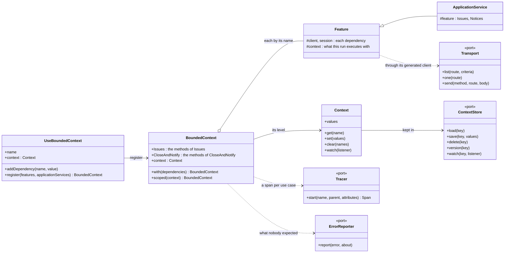
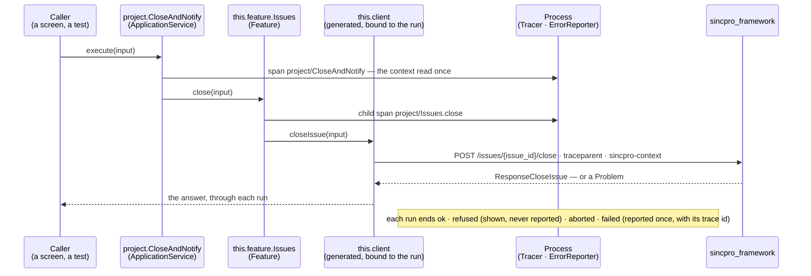
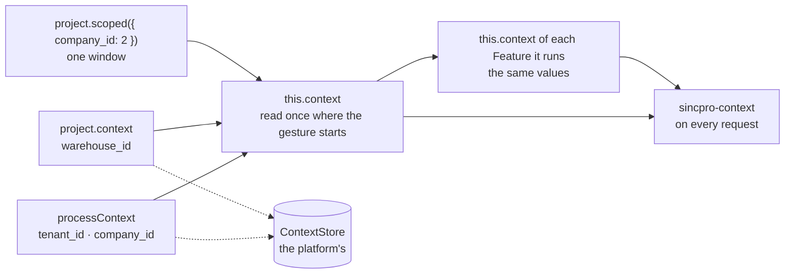
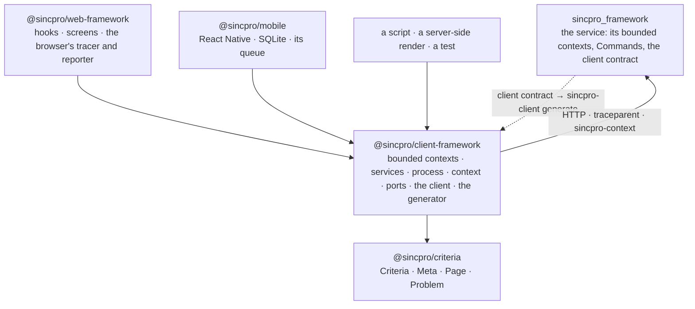

# @sincpro/client-framework

**The client side of [sincpro_framework](https://github.com/Sincpro-SRL/sincpro_framework), for
every platform.** Write a use case once — a `Feature`, or an `ApplicationService` that composes
Features — and run it in a browser, on a phone, in a server-side render, in a script or in a test.
Every use case is traced and every unexpected error reported, continuing the backend's trace,
without its author writing either. A service's client contract becomes typed code for each of
its bounded contexts.

> **Status: 0.x.** The API may still change before 1.0. In: the client, the generator, the
> bounded context with its `Feature` and `ApplicationService`, the process (tracing, error
> reporting, the context) and its ports. Read the [manifesto](MANIFESTO.md) for what this package
> is responsible for, what it is not and where it is going, and the
> [ubiquitous language](docs/UBIQUITOUS_LANGUAGE.md) every Sincpro framework shares.

## What it gives, at a glance



`configureProcess({ tracer, reporter, context })` plugs the ports once; `processContext` is the
process's level of the context. Beside them: the generated client (`sincpro-client generate`),
`entity()`, model definitions (`defineMeta`, `metaFromSchema`) and client-side ids.

## A bounded context, set up like the backend's

Each bounded context of an application has the layout sincpro_framework gives a service: what its
services can count on, its bases, its services, and the one object the rest of the application
uses it through.

```mermaid
flowchart LR
  subgraph py["sincpro_framework · Python"]
    direction TB
    pd["infrastructure/dependencies.py<br/>DependencyContextType · add_dependency"]
    pf["infrastructure/framework.py<br/>Feature · ApplicationService · UseFramework"]
    ps["services/<br/>@bus.feature · @bus.app_service"]
    pi["__init__.py<br/>the bounded context"]
    pd --> pf --> ps --> pi
  end
  subgraph ts["@sincpro/client-framework · TypeScript"]
    direction TB
    td["infrastructure/dependencies.ts<br/>ProjectDependencies · addDependency"]
    tf["infrastructure/bounded_context.ts<br/>Feature · ApplicationService · UseBoundedContext"]
    tsv["services/<br/>features · applicationServices"]
    ti["index.ts<br/>export const project"]
    td --> tf --> tsv --> ti
  end
  ti --> users["a screen · another bounded context · a test<br/>project.Issues.close(input)"]
  pi -. "the client contract" .-> td
```



```ts
// domains/project/infrastructure/dependencies.ts — what the services can count on
export interface ProjectDependencies {
  client: ProjectClient; // generated from the service's contract
  session: Session;
}

export function registerDependencies(bc: UseBoundedContext<ProjectDependencies>) {
  bc.addDependency("client", clientOf(transport));
  bc.addDependency("session", session);
  return bc;
}
```

```ts
// domains/project/infrastructure/bounded_context.ts
import {
  ApplicationService as BaseApplicationService,
  Feature as BaseFeature,
  UseBoundedContext,
} from "@sincpro/client-framework";

import type { ProjectFeatures } from "../services";

export class Feature extends BaseFeature<ProjectDependencies> {}
export class ApplicationService extends BaseApplicationService<
  ProjectDependencies,
  ProjectFeatures
> {}

export function configProjectBoundedContext(name: string) {
  return registerDependencies(new UseBoundedContext<ProjectDependencies>(name));
}
```

```ts
// domains/project/services/issues.ts — a Feature is a facade: one part of the domain
export class Issues extends Feature {
  close(input: dto.CommandCloseIssue) {
    this.session.require(); // each dependency is a typed property
    return this.client.closeIssue(input); // carries this run's traceparent
  }
}

// domains/project/services/close_and_notify.ts — composes the Features of its bounded context
export class CloseAndNotify extends ApplicationService {
  async execute(input: dto.CommandCloseIssue) {
    await this.feature.Issues.close(input); // a child span, the same trace
    return this.feature.Notices.tell(input);
  }
}

// domains/project/services/index.ts
export const features = { Issues, Notices };
export const applicationServices = { CloseAndNotify };
export type ProjectFeatures = typeof features;
```

```ts
// domains/project/index.ts
export const project = configProjectBoundedContext("project").register({
  features,
  applicationServices,
});

// anywhere: a screen, a script, a test
await project.Issues.close(input); // span project/Issues.close
await project.CloseAndNotify.execute(input); // project/CloseAndNotify → its Features under it
```

Every public method is a use case: a span named as the backend names its own
(`project/Issues.close`, identity `project.Issues.close`), and a report when it fails in a way
nobody expected. One gesture is one trace, from the click to the database:



`project` holds references only — each service is made once, the first time it is
asked for — and it is never frozen: `project.with({ client: fake })` and
`project.scoped({ company_id: 2 })` derive a variant that shares everything else.

## The process: tracing, errors and the context

What every bounded context runs with is set once, where the application starts — the way the
backend's process is. All of it is optional:

```ts
// entrypoints/main.ts
configureProcess({
  tracer, // the platform's Tracer
  reporter, // the platform's ErrorReporter
  context: memoryContexts(), // where the context lives (this is the default)
});

processContext.set({ tenant_id: "acme" }); // every use case runs with it and sends it
project.context.set({ warehouse_id: 4 }); // only what «project» runs
```

A service reads it as `this.context` — the process's values, under them its bounded context's,
under them a scope's, read once where the gesture started — and every request it sends carries
it in `sincpro-context`. A screen hears it change with `processContext.watch(…)`.



The context lives in a `ContextStore`, the port each platform implements with its own technology:
memory by default, `sessionStorage` or the screens' own store in a browser, MMKV on a phone,
`AsyncLocalStorage` in a server that renders. The services never know which.

`tracer` and `reporter` are injected by the application — this package initialises nothing.
Any object that fulfils the port works; for the common vendors there are optional adapters that
wrap what the application built:

```ts
import { openTelemetryTracer } from "@sincpro/client-framework/opentelemetry"; // peer: @opentelemetry/api
import { sentryReporter } from "@sincpro/client-framework/sentry"; // no dependency

const tracer = openTelemetryTracer(provider.getTracer("my-app")); // the app's provider and exporter
const reporter = sentryReporter(client); // the app's Sentry-compatible client (GlitchTip too)
```

Nothing is installed or shipped unless it is imported, and without a tracer or a reporter every use
case runs the same — nothing traces, nothing reports. In a test, `memoryTracer()` and
`memoryReporter()` (`@sincpro/client-framework/testing`).

## Values on the wire

The backend writes every message with one set of rules, and every client reads and writes them
the same — so they live here, not in each platform:

| Value       | Travels as                                 | Here                                             |
| ----------- | ------------------------------------------ | ------------------------------------------------ |
| a decimal   | text, every digit: `"10.50"`               | `Decimal` — exact, on `BigInt`; rounds half up   |
| a money     | `{ "amount": "10.50", "currency": "BOB" }` | `Money` — never adds two currencies              |
| a day       | `"2026-10-02"`, never converted            | `isDay`, `dayOf(instant, zone)` for «today»      |
| an instant  | ISO text: `"2026-10-02T14:30:00Z"`         | `wallTimeOf` / `instantOf` on the company's zone |
| an id       | a UUID v7 as 32 hex                        | `newEntityId`, `isEntityId`, `momentOf`          |
| bytes       | `{ "$bytes": "<base64>" }`                 | `valuesOf` / `readValues`                        |
| the context | only what travels: text, numbers, lists    | `plainCodec`, `travelling`                       |

```ts
import { Money, pack, unpack, valuesOf } from "@sincpro/client-framework";

const line = new Money("19.90", "BOB").times("3"); // 59.70 BOB, exact
const total = Money.total([line, delivery], "BOB").rounded(); // to the currency's decimals
valuesOf({ total, at: new Date() }); // { total: { amount, currency }, at: "…Z" }
const answer = unpack(text, Money); // a typed read when asked for — never imposed
```

Not restrictive, like the backend: reading keeps every key it finds, a typed read is asked for
(`rebuilt(values, Money)`), any currency code is read, and an application adds its own decimals
(`Money.decimals["USDT"] = 6`). What JSON cannot write (`NaN`, a function, a cycle) is refused at
once, naming where. Showing a value to a person — `Intl.NumberFormat`, a date picker — is each
platform's, never this package's.

## Where it sits



No React, no DOM, no platform: what a platform must provide — how a span is exported, where an
error is reported, where the context lives — it plugs through a port.

## On each platform

This package asks the platform for little: `fetch`, `AbortSignal`, `URL` / `URLSearchParams`,
`crypto.getRandomValues` (client-side ids, retry keys), `Proxy` / `WeakMap`. Browsers and Node 26
have them all. **React Native** (Hermes) needs two polyfills, installed once where the app
starts, before anything imports this package:

```ts
import "react-native-get-random-values"; // or expo-crypto's getRandomValues polyfill
import "react-native-url-polyfill/auto"; // RN's own URL resolves relative paths poorly
```

`memoryTransport` copies with `structuredClone` where the engine has it and a JSON round trip
where it does not. The OpenTelemetry adapter takes `@opentelemetry/api` from 1.9, the version
`@sincpro/mobile` runs.

The services are the same everywhere; each platform plugs its own technology behind the same
three ports, in its `main`:

| Port            | Browser (@sincpro/web-framework)                | Phone (@sincpro/mobile)                    | Test              |
| --------------- | ----------------------------------------------- | ------------------------------------------ | ----------------- |
| `Tracer`        | OpenTelemetry + OTLP/HTTP (`./telemetry`)       | OpenTelemetry with its queue and exporter  | `memoryTracer`    |
| `ErrorReporter` | GlitchTip / Sentry browser client (`./errors`)  | Sentry React Native client                 | `memoryReporter`  |
| `ContextStore`  | memory, `sessionStorage`, or the screens' store | MMKV, or memory hydrated from AsyncStorage | `memoryContexts`  |
| `Transport`     | `restTransport` over `fetch`                    | `restTransport`, or SQLite offline         | `memoryTransport` |

A store's reads are synchronous — a use case reads its context where a gesture starts and never
waits for it — so an asynchronous storage is held in memory and written through.

## Development

Node 26 (`nvm use`).

```bash
make init            # pre-commit + dependencies
make test            # vitest, in Node
make verify-format   # format + lint + doctor; fails if the tree is left dirty (what CI runs)
make build           # tsc into dist/
```

`make doctor` enforces what the type checker cannot: the source imports itself, never a relative
path; no React, no UI, no browser global; Node only inside the generator. Read
[`AGENTS.md`](AGENTS.md) before changing anything, and [`CONTRIBUTING.md`](CONTRIBUTING.md)
before opening a pull request.

## CI/CD

Every workflow in `.github/workflows/` delegates to
[`Sincpro-SRL/.github`](https://github.com/Sincpro-SRL/.github) and only calls `make` targets:
checks on every pull request and push to `main`, a release draft on `main`, publication to npm
when a release is published, and notifications. The version is written by the release pipeline,
never by hand.

## License

[MIT](LICENSE)
