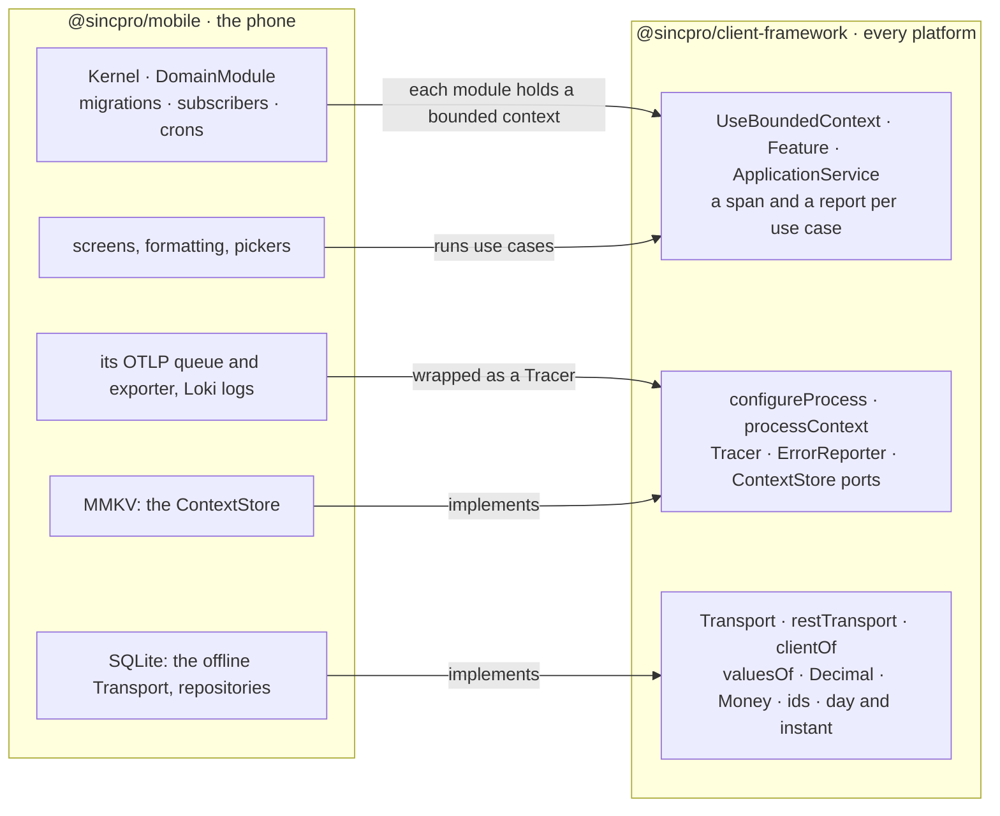

# @sincpro/mobile on @sincpro/client-framework

How @sincpro/mobile adopts this package: what it takes from here, what stays its own, and the
order to move in. The rule is the same for every platform — **what is transversal comes from
here; what needs the phone stays in mobile**: SQLite, its queues, its migrations and workers, its
screens, how a value is shown to a person.



## What maps to what

| mobile today                                                               | from client-framework                                                                                          | why it moves                                                                                                                                            |
| -------------------------------------------------------------------------- | -------------------------------------------------------------------------------------------------------------- | ------------------------------------------------------------------------------------------------------------------------------------------------------- |
| `Feature<Deps>` with `this.deps`, spans named `ClassName.method`           | `class Feature extends BaseFeature<Dependencies>`, `this.client`, spans `<bounded context>/<Service>.<method>` | A release build minifies class names: `new.target.name` becomes `a.b`. The registered name never changes.                                               |
| `ApplicationService<TFeatures>` with `this.features.x`                     | `this.feature.Issues.close(…)`                                                                                 | The same rule — it composes the Features of its own bounded context — with the services registered once.                                                |
| `ContextManager`, `StackContextManager`, `WithContext`, `PropagateContext` | `processContext`, `project.context`, `project.scoped({…})`, `this.context`                                     | A global stack mixes the parents of two calls running at once; here each call carries its execution. The levels are sincpro_framework's.                |
| `DomainModule` (`key`, `repositories()`)                                   | `new UseBoundedContext<Dependencies>(key)` with `addDependency` for each repository                            | A module's services and what they need become the bounded context; `migrations()`, `subscribers()`, `crons()` and `persistOnReset()` stay the module's. |
| `Kernel`, `createApp(AppConfig)`                                           | `configureProcess({ tracer, reporter, context })`, once, before the first screen                               | What every use case runs with is the process's; the Kernel keeps the database, the migrations and the workers.                                          |
| `init_telemetry` (OTLP client, SQLite span queue, sampler)                 | the `Tracer` port: `openTelemetryTracer(provider.getTracer("app"))` from `./opentelemetry`                     | The span per use case, its parent and the `traceparent` on every request are the same on the web; the queue and the exporter are the phone's.           |
| error reporting                                                            | the `ErrorReporter` port: `sentryReporter({ captureException: Sentry.captureException })` from `./sentry`      | Only what nobody expected is reported, once, with its trace id — a 4xx the server explained is the business answering.                                  |
| `generateUUID()` — `uuid` v7 with hyphens                                  | `newEntityId()`, `isEntityId()`, `momentOf()`                                                                  | The backend writes 32 hex; an id minted on the phone must be one the server accepts as a new record's key.                                              |
| `monetary.ts` — `Number(new Big(…))`                                       | `Decimal`, `Money` (`{ amount, currency }`)                                                                    | It turns a decimal into a float, the thing the backend sends text to avoid. Keep `formatTwoDecimals` for showing, fed with text.                        |
| `date.ts` with `dayjs`                                                     | `isDay`, `dayOf`, `wallTimeOf`, `instantOf`, `installTimeZone`                                                 | A day is never an instant; «today» is the company's, not the device's. `dayjs` stays for formatting.                                                    |
| `JsonSerializerAdapter.cleanData` (every `Date` → ISO)                     | `valuesOf` / `readValues` / `pack` / `unpack`                                                                  | One set of wire rules: decimals as text, bytes tagged, a day kept a day. `canonicalize` and its SHA-256 stay mobile's, written over `valuesOf`.         |
| its HTTP calls                                                             | `restTransport` and the generated `clientOf(transport)` (`sincpro-client generate`)                            | The routes, the bodies and the answers are typed from the service's contract, and each request carries its use case's trace.                            |
| SQLite reads and writes offline                                            | implement the `Transport` port over SQLite                                                                     | A use case does not know whether it is online: the same `this.client` over another transport.                                                           |

What stays mobile's and does not come here: SQLite and its repositories, migrations, the dead
letter queue, crons and the flush worker, Loki logs, `event_driven` subscribers, screens and the
design of the phone.

## The setup, on a phone

```ts
// index.js — before anything imports @sincpro/client-framework
import "react-native-get-random-values"; // or expo-crypto's getRandomValues polyfill
import "react-native-url-polyfill/auto";
```

```ts
// entrypoints/main.ts — the process, once
import { configureProcess, processContext } from "@sincpro/client-framework";
import { openTelemetryTracer } from "@sincpro/client-framework/opentelemetry";
import { sentryReporter } from "@sincpro/client-framework/sentry";
import * as Sentry from "@sentry/react-native";

configureProcess({
  tracer: openTelemetryTracer(provider.getTracer("pos-mobile")), // mobile's provider and queue
  reporter: sentryReporter({ captureException: Sentry.captureException }),
  context: mmkvContexts(),
});
processContext.set({ tenant_id: session.tenant, company_id: session.company });
```

The bounded contexts are set up exactly as on the web (`infrastructure/dependencies.ts`,
`infrastructure/bounded_context.ts`, `services/`, `index.ts` — see the README), with mobile's
repositories as dependencies:

```ts
export interface SalesDependencies {
  client: SalesClient; // generated, over restTransport or the SQLite transport
  orders: OrderRepository; // mobile's SQLite repository
}
```

A `DomainModule` keeps what is the phone's and hands its services to the bounded context:

```ts
export class SalesModule extends DomainModule {
  readonly key = "sales";
  readonly name = "Sales";
  readonly boundedContext = sales; // export const sales = configSalesBoundedContext("sales").register(…)
  migrations() {
    return salesMigrations;
  }
  subscribers() {
    return [new OrderPaidSubscriber(sales)];
  }
}
```

## The context store over MMKV

The context lives in a `ContextStore`; on a phone, MMKV is synchronous, which is what the port
asks (a use case reads its context where a gesture starts and never waits for it).

```ts
import { type ContextStore, plainCodec } from "@sincpro/client-framework";
import { MMKV } from "react-native-mmkv";

export function mmkvContexts(storage = new MMKV({ id: "sincpro-context" })): ContextStore {
  const versions = new Map<string, number>();
  const moved = (key: string) => versions.set(key, (versions.get(key) ?? 0) + 1);
  // A change made anywhere moves the key's version, so a level reads it again.
  storage.addOnValueChangedListener(moved);
  return {
    load(key) {
      const text = storage.getString(key);
      return text === undefined ? undefined : plainCodec.loads(text);
    },
    save(key, values) {
      storage.set(key, plainCodec.dumps(values));
      moved(key);
    },
    delete(key) {
      storage.delete(key);
      moved(key);
    },
    version: (key) => versions.get(key) ?? 0,
    watch(key, listener) {
      const listening = storage.addOnValueChangedListener((changed) => {
        if (changed === key) listener();
      });
      return () => listening.remove();
    },
  };
}
```

AsyncStorage is asynchronous: hold the context in memory (`memoryContexts()`), load it from
AsyncStorage before the first screen, and write it through on each change.

## What the phone must give

| Asked of the platform                      | Hermes (React Native)                                                                                                                                       |
| ------------------------------------------ | ----------------------------------------------------------------------------------------------------------------------------------------------------------- |
| `crypto.getRandomValues` (ids, retry keys) | a polyfill: `react-native-get-random-values` or expo-crypto's                                                                                               |
| `URL`, `URLSearchParams`                   | `react-native-url-polyfill/auto` — RN's own resolves relative paths poorly                                                                                  |
| `BigInt` (`Decimal`, `Money`)              | yes                                                                                                                                                         |
| `Intl.DateTimeFormat` with `timeZone`      | check `wallTimeOf("2026-03-12T14:30:00Z", "America/La_Paz") === "2026-03-12T10:30"` on the devices; else `@formatjs/intl-datetimeformat` with its zone data |
| `fetch`, `AbortSignal`                     | yes                                                                                                                                                         |
| `@opentelemetry/api`                       | from 1.9, the version mobile runs                                                                                                                           |

## The order to move in

1. **The wire values** — `newEntityId`, `Decimal`/`Money`, `valuesOf`, the day and the instant.
   They fix real bugs today (a float amount, a day that moves, ids the backend does not accept)
   and touch no architecture. Rows already stored with hyphenated ids are read in either form.
2. **The process** — `configureProcess` with mobile's tracer and reporter, and `mmkvContexts`.
3. **One bounded context at a time** — its Features on `BaseFeature<Dependencies>`, registered,
   used as `sales.Orders.place(…)`; the old `Feature` and the context stack go when the last one
   moved.
4. **The generated client** for each service with a contract, over `restTransport` online and the
   SQLite transport offline.

The words are the shared ones ([`UBIQUITOUS_LANGUAGE.md`](UBIQUITOUS_LANGUAGE.md)): a module that
holds a bounded context is still called a bounded context in code and docs.
