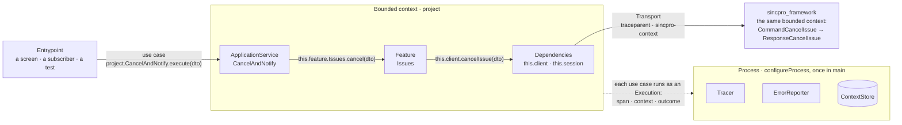

# Ubiquitous language

One vocabulary for every Sincpro framework: **sincpro_framework** (Python, the backend),
**@sincpro/client-framework** (TypeScript, every client), **@sincpro/web-framework** (the
browser) and **@sincpro/mobile** (React Native). Whoever knows a word in one knows it in the
others: the same thing has the same name, and one name means one thing.

The backend is the source of the words. When it renames one (sincpro_framework#245: the
framework instance _is_ a bounded context), every client follows, in the same release train.

## The words, in one picture

## The words

| Word                   | What it is                                                                                                                                                      | sincpro_framework                                                                    | @sincpro/client-framework                                                            | @sincpro/web-framework                                     | @sincpro/mobile (today)                      |
| ---------------------- | --------------------------------------------------------------------------------------------------------------------------------------------------------------- | ------------------------------------------------------------------------------------ | ------------------------------------------------------------------------------------ | ---------------------------------------------------------- | -------------------------------------------- |
| **Bounded context**    | The unit of the model: its language, its services, its dependencies. Named once (`"project"`); everything it holds is reached through it.                       | `UseFramework("project")` (#245: `bounded_context`), its folder `domains/project/`   | `new UseBoundedContext("project")` → `project`                                       | the folder `domains/project/`, its `index.ts`              | `DomainModule`                               |
| **Dependencies**       | What the services of a bounded context can count on, typed once and added once.                                                                                 | `ProjectDependencyContextType`, `add_dependency` in `infrastructure/dependencies.py` | `interface ProjectDependencies`, `addDependency` in `infrastructure/dependencies.ts` | the same                                                   | `repositories()`                             |
| **Service**            | A `Feature` or an `ApplicationService`: where all of a bounded context's logic lives.                                                                           | the same                                                                             | the same                                                                             | the same — screens only run them                           | the same                                     |
| **Feature**            | One part of the domain, traced and reported by its bounded context.                                                                                             | one Command: `@bus.feature(CommandX)`, `execute(dto)`                                | a facade: each public method one use case (`Issues.cancel`, `Issues.send`)           | —                                                          | `Feature`                                    |
| **ApplicationService** | Composes the Features of its own bounded context — never another ApplicationService.                                                                            | `@bus.app_service(CommandX)`, `self.feature_bus.execute(...)`                        | `this.feature.Issues.cancel(dto)`                                                    | —                                                          | `ApplicationService`                         |
| **Use case**           | One operation a person or a system asks for. The unit of a span and of an error report. Reusing one is calling it through its bounded context, never a helper.  | a Command executed on the bus                                                        | a public method of a service: `project.Issues.cancel(dto)`                           | `useService(project.Issues.cancel)`                        | a Feature's method                           |
| **Command, Response**  | A use case's input and its answer: the contract (DTOs).                                                                                                         | `CommandCancelIssue`, `ResponseCancelIssue`                                          | generated `dto.CommandCancelIssue`, `dto.CommandCancelIssueAnswer` (see below)       | —                                                          | —                                            |
| **Client contract**    | What a service publishes about itself: operations, models, bindings. The generator's input.                                                                     | `export-client-contract`                                                             | `sincpro-client generate` → `domain.ts`, `client.ts`, `entities.ts`                  | —                                                          | —                                            |
| **Transport**          | The seam with a server.                                                                                                                                         | —                                                                                    | `Transport`: `restTransport`, `memoryTransport`                                      | `cachedTransport`                                          | its own REST and SQLite                      |
| **Process**            | What every bounded context of a program runs with: who traces, who reports, where the context lives. Set once, in `main`.                                       | `sincpro_framework.observability.process`, `store_context_in` in `main()`            | `configureProcess({ tracer, reporter, context })`                                    | `entrypoints/<app>/main.tsx`                               | `Kernel`, `AppConfig`                        |
| **Context**            | The values every use case runs with and sends to the server: the tenant, the company. Only this: never a bounded context's name.                                | `use_context()`, `self.context`, `ContextKey`                                        | `processContext`, `project.context`, `project.scoped(…)`, `this.context`             | `useContextValues(level)`                                  | `ContextManager`, `ContextKey`               |
| **Context store**      | Where the context lives — the platform's technology behind one port.                                                                                            | `ContextStore`: `InMemoryContexts`, `KeyValueContexts`                               | `ContextStore`: `memoryContexts`, or the platform's                                  | memory, `sessionStorage`, the screens' store               | MMKV, memory over AsyncStorage               |
| **Execution**          | One run of a use case: its id, its span, its context read once, its parent.                                                                                     | `Execution`, `Chain`                                                                 | `Execution` (handed to dependencies through `BIND`)                                  | —                                                          | an entry of the context stack                |
| **Span, trace**        | One span per use case, named `<bounded context>/<Name>`; the trace continues from the client to the database.                                                   | `project/CommandCancelIssue`, `sincpro.use_case` `project.CommandCancelIssue`        | `project/Issues.cancel`, `sincpro.use_case` `project.Issues.cancel`                  | —                                                          | per Feature                                  |
| **Outcome**            | How a use case ended: `ok`, `refused` (the business said no — shown, never reported), `aborted`, `failed` (reported once).                                      | `sincpro.outcome`                                                                    | `Outcome`, `outcomeOf`                                                               | `Refused` draws a refusal                                  | —                                            |
| **Problem**            | The server's explanation of a refusal (RFC 9457): kind, reason, next step, errors by JSON pointer.                                                              | `Problem`                                                                            | `TransportError.problem`                                                             | `Refused`, `explain`, `errorsByField`                      | —                                            |
| **Entrypoint**         | Where the outside comes in. Composes; holds no logic.                                                                                                           | `entrypoints/` (http, mcp, cron, subscriber)                                         | —                                                                                    | `entrypoints/<app>/`, a bounded context's views and `live` | screens                                      |
| **Adapter**            | A wrapper of something external that is part of the business problem — or, inside a framework, a port's implementation.                                         | `adapters/`                                                                          | `./opentelemetry`, `./sentry` (a port's implementation)                              | `./telemetry`, `./errors`                                  | —                                            |
| **Infrastructure**     | Wiring and the non-functional: what can be swapped without changing the business.                                                                               | `infrastructure/`                                                                    | `infrastructure/dependencies.ts`, `infrastructure/bounded_context.ts`                | the same                                                   | `infrastructure/`                            |
| **Domain**             | The `domain/` layer: the bounded context's vocabulary and pure rules. Never the name of a bounded context.                                                      | `domain/`                                                                            | generated `domain.ts`, the app's `domain/`                                           | the same                                                   | `domain/`                                    |
| **Entity, aggregate**  | A thing with an identity that a screen lists and opens; an aggregate is the one its changes go through.                                                         | `ddd`: entities and aggregates; the metamodel                                        | `entity()`, `Meta`, `defineMeta`                                                     | `EntityList`, `EntityRecord`                               | entities over SQLite                         |
| **Entity id**          | A record's key, minted where the record is born — the client names a new record before the server sees it. A UUID v7 as 32 hex: it sorts by when it was minted. | `new_entity_id()` (`common/ids/uuid7.py`)                                            | `newEntityId()`, `isEntityId()`; also each execution's id                            | `useRecord` mints it for a new record                      | `generateUUID()` — 36 characters (see below) |
| **Values on the wire** | How any value is written as JSON and read back: a decimal as text, a day as a day, bytes tagged. A typed read is asked for, never imposed.                      | `values_of`, `read_values`, `rebuilt`, `pack`, `unpack` (`common/serialization`)     | `valuesOf`, `readValues`, `rebuilt`, `pack`, `unpack`                                | the same                                                   | `JsonSerializerAdapter` (see below)          |
| **Decimal**            | An exact number: travels as text, never a float; rounds only when asked, half up.                                                                               | `Decimal`                                                                            | `Decimal`                                                                            | a field `number` with `exact`                              | `big.js`, turned into a float (see below)    |
| **Money**              | An amount and its currency: `{"amount": "10.50", "currency": "BOB"}`; two currencies never add.                                                                 | `Money`, `MultiCurrency`, `ExchangeRate`                                             | `Money`                                                                              | —                                                          | `monetary.ts`                                |
| **Day, instant**       | A day of the calendar (`"2026-10-02"`, never converted) and an instant (ISO, read on the company's zone).                                                       | `date`, `datetime`                                                                   | `isDay`, `dayOf`, `wallTimeOf`, `instantOf`, `installTimeZone`                       | `FrameworkProvider timeZone`                               | `date.ts` with `dayjs`                       |
| **Codec**              | How a context is written to text: only what travels.                                                                                                            | `ContextCodec`: `PlainCodec`, `TypedCodec`, `PickleCodec`                            | `ContextCodec`: `plainCodec`                                                         | —                                                          | —                                            |

## Words we do not use

| Instead of                                 | Say                               | Why                                                                                    |
| ------------------------------------------ | --------------------------------- | -------------------------------------------------------------------------------------- |
| runtime (the concept)                      | process, execution                | The process is set once in `main`; an execution is one run. «Runtime» named both.      |
| framework, framework instance, bus, module | bounded context                   | sincpro_framework#245. The bus is the backend's dispatch mechanism, not a client word. |
| domain, for a bounded context              | bounded context                   | `domain/` is a layer inside it.                                                        |
| deps, `this.deps.x`                        | dependencies, `this.x`            | A dependency is a property of the service, typed by the bounded context.               |
| context, for a bounded context's name      | bounded context                   | `context` alone is only the values a use case runs with (#245).                        |
| helper, `existing_*`, `*_command(…)`       | the use case, called by its name  | A wrapper skips the trace and the report.                                              |
| shared state, a global store               | the context (a handful of values) | Screens' state is the platform's; the context is not a state manager.                  |

## Where the words still differ

Each of these is a real divergence today. They are listed so that nobody adds a third name.

1. **The answer: `Response` or `Answer`.** The backend names it `ResponseCancelIssue`, and the
   client contract carries that name (`output.title`); the generator writes
   `CommandCancelIssueAnswer`. Proposed: generate the backend's own name, with
   `CommandCancelIssueAnswer` as a deprecated alias for one minor. Owner: client-framework's
   generator.
2. **The bounded context's name on a span.** The backend writes it in `sincpro.context` today,
   and the client does the same so their spans group together; #245 says `context` alone is only
   the runtime context. Proposed: `sincpro.bounded_context` in both, in the same release.
   Owner: sincpro_framework#245, then client-framework.
3. **A Feature's shape.** On the backend a Feature handles one Command (`execute(dto)`); on the
   client it is a facade whose methods are the use cases, each calling one Command of its server.
   The words agree — a Feature is traced, reported, and composed only by an ApplicationService —
   but a person reading both should know the shape differs. Proposed: keep it, and let the
   backend's docs say a client groups Commands this way.
4. **`domain` where a bounded context is meant.** An entity key (`project:issue`), composer's
   `ResourceRef.domain`, `EntityRef.domain` and the generator's `--domain` flag name the bounded
   context `domain`. Proposed: `bounded_context` (and `alias` where it is the published name, as
   the client contract says them apart), changed together. Owner: composer (`ResourceRef`), then
   client-framework and web-framework.
5. **`common/` or `shared/`.** forge and web-framework's architecture use `common/`;
   `sincpro_architecture_guidelines` forbids `common/` and says `shared/`. Owner: the guideline
   (the architecture page chose `common`, as the backend has it).
6. **mobile's own words.** `DomainModule`, `Kernel` and a `ContextManager` with a global stack are
   the bounded context, the process and the context under other names. Proposed: mobile adopts
   this package and its words. Owner: @sincpro/mobile.
7. **mobile's ids.** mobile mints with the `uuid` package (`generateUUID()`): a UUID v7, but
   written with hyphens (36 characters), where the backend and this package write 32 hex — an id
   minted on the phone is not `isEntityId`. Proposed: mobile mints with `newEntityId()` when it
   adopts this package, and reads the rows it already stored in either form. Owner: @sincpro/mobile.
8. **mobile's values on the wire.** `monetary.ts` turns a decimal into a JavaScript number
   (`Number(new Big(…))`) — the float the backend sends text to avoid — and
   `JsonSerializerAdapter` writes every `Date` as an instant, so a day held in a `Date` can land
   on the day before. Proposed: mobile writes and reads with `valuesOf` / `Money` / `Decimal`, and
   keeps `big.js` and `dayjs` for what is its own (formatting, pickers). Owner: @sincpro/mobile.
9. **`UseFramework` or `UseBoundedContext`.** #245 leaves open whether the backend's class is
   renamed; the client already says `UseBoundedContext`. Whichever the backend decides, both end
   with the same word.

## How a word changes

A new word, or a word that changes, is written here first — in the same pull request as the code
that uses it — and in the backend's docs when it is the backend's. A word that exists here is
never translated in code; Spanish prose keeps it as it is (_el bounded context_, _una Feature_).
